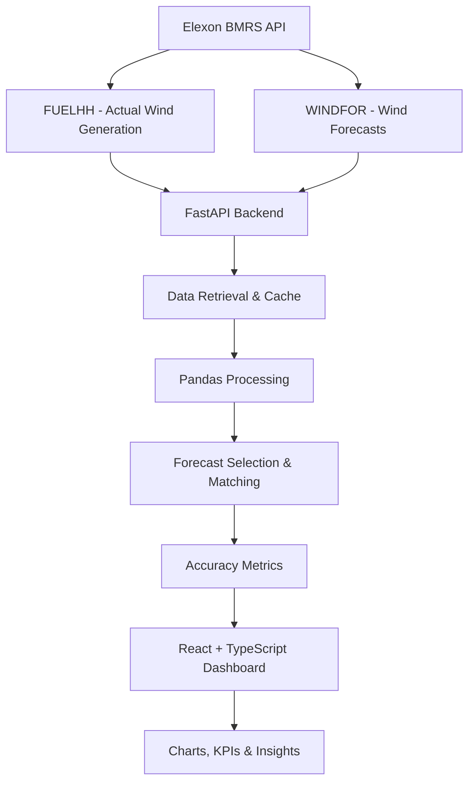

# 🌬️ Wind Forecast Intelligence

### Day-Ahead Wind Generation Forecasting & Accuracy Analytics

A full-stack analytics dashboard for monitoring UK national wind generation forecasts, comparing predicted generation against actual output, and evaluating forecast accuracy to support day-ahead energy procurement decisions.

<p align="center">

**[🚀 Live Dashboard](https://wind-forecast-intelligencee-ek1m.vercel.app/) · [⚙️ Backend API](https://wind-forecast-intelligencee.onrender.com/api/health) · [💻 GitHub Repository](https://github.com/esha-05/wind-forecast-intelligencee)**

</p>

---

## 📊 Project at a Glance

| Category | Details |
|---|---|
| Project | Wind Forecast Intelligence |
| Domain | Energy Analytics |
| Data Provider | Elexon BMRS |
| Frontend | React, TypeScript, Vite |
| Backend | Python, FastAPI |
| Data Processing | Pandas |
| Visualisation | Recharts |
| Deployment | Vercel + Render |
| Evaluation Period | January 2026 |

## 🎯 The Problem

Energy procurement teams need reliable estimates of future wind generation to make informed purchasing decisions.

However, forecast values can differ significantly from actual generation, creating uncertainty in day-ahead planning.

**This project addresses three key questions:**

1. What was the latest eligible national wind generation forecast available before the decision cutoff?
2. How closely did the forecast match actual wind generation?
3. How much forecast error and systematic bias occurred during the evaluation period?

## ✨ Key Features

| Feature | Description |
|---|---|
| 📈 Forecast Monitoring | View national wind generation forecasts by delivery date. |
| ⏱️ Cutoff Selection | Evaluate forecasts using a configurable day-ahead publication cutoff. |
| 📊 Accuracy Analytics | Calculate MAE, RMSE, Bias and MAPE. |
| 🔍 Forecast Comparison | Compare forecast and actual generation over hourly intervals. |
| 📅 Historical Evaluation | Explore daily performance throughout January 2026. |
| 🔄 Data Refresh | Retrieve updated source data through the backend API. |
| 📱 Responsive Interface | Dashboard layout for desktop and mobile screens. |

## 🖥️ Dashboard Preview

<!-- Add your actual dashboard screenshots here after uploading them to the repository. -->

| Forecast Overview | Accuracy Analytics |
|---|---|
| Add overview screenshot here | Add accuracy screenshot here |

## 🏗️ System Architecture



### Technology Stack

| Layer | Technologies |
|---|---|
| Frontend | React, TypeScript, Vite |
| UI & Charts | CSS, Recharts |
| Backend | Python, FastAPI |
| Data Processing | Pandas, NumPy |
| HTTP Integration | HTTPX |
| Testing | Pytest, Vitest |
| Containerisation | Docker, Docker Compose |
| Deployment | Vercel, Render |
| Data Source | Elexon BMRS API |

## 📡 Data Sources

The application uses two Elexon datasets.

**1. FUELHH — Actual Generation**

- Retrieves half-hourly generation records.
- Filters national wind generation using `fuelType=WIND`.
- Uses `generation`, `startTime` and `settlementPeriod`.

**2. WINDFOR — Wind Generation Forecast**

- Retrieves published national wind forecasts.
- Uses `publishTime` to identify forecast publication versions.
- Uses `startTime` to match forecasts with delivery hours.
- Uses `generation` as the forecast value.

No external weather data or synthetic forecast values are used.

## ⚙️ Forecast Evaluation Methodology

### Decision Cutoff

The evaluation uses the following assumption:

**08:00 UTC on the day before delivery (D-1).**

This is a configurable project assumption, not an official Elexon market rule.

### Forecast Selection Process

1. Retrieve available WINDFOR forecast publications.
2. Filter out publications after the decision cutoff.
3. Group forecasts by delivery timestamp.
4. Select the latest eligible publication for each delivery hour.
5. Match the selected forecast with actual wind generation.

### Actual Generation Processing

FUELHH provides 48 half-hourly readings per day.

The application aggregates two consecutive half-hourly readings into one hourly actual generation value.

Both readings must be present. Missing values are not replaced with zero.

### Accuracy Metrics

| Metric | Formula / Meaning |
|---|---|
| MAE | Average absolute forecast error |
| RMSE | Square root of mean squared forecast error |
| Bias | Average signed forecast error |
| MAPE | Average absolute percentage error |
| Coverage | Matched intervals / expected intervals |

**Error convention:**

`Forecast Error = Forecast - Actual`

- Positive error: Forecast overestimation.
- Negative error: Forecast underestimation.

MAPE excludes intervals where absolute actual generation is below 1 source unit. All other metrics use matched intervals.

## 📈 January 2026 — Evaluation Results

<details>
<summary><strong>View monthly performance results</strong></summary>

| Metric | Result |
|---|---:|
| Evaluation days | 31 |
| Expected intervals | 744 |
| Matched intervals | 744 |
| Data coverage | 100% |
| MAE | 2,142.12 |
| RMSE | 2,611.70 |
| Bias | +1,851.90 |
| MAPE | 22.38% |

</details>

### Forecast Error Distribution

| Error Direction | Intervals | Share |
|---|---:|---:|
| Forecast overestimation | 633 | 85.1% |
| Forecast underestimation | 111 | 14.9% |
| Zero error | 0 | 0% |

**Key Insight**

The positive monthly bias indicates that the selected wind forecasts generally overestimated actual generation during January 2026.

The MAE of 2,142.12 source units indicates the average absolute difference between forecast and actual generation across the 744 matched hourly intervals.

## 🔬 Independent Data Validation

The deployed application was compared against independently retrieved raw records from the Elexon BMRS API.

### Actual Generation Validation

| Validation Check | Expected / Retrieved |
|---|---:|
| Half-hourly records expected | 1,488 |
| Records retrieved | 1,488 |
| Unique timestamps | 1,488 |
| Duplicate timestamps | 0 |
| Incomplete settlement days | 0 |
| Hourly actuals constructed | 744 |

### Forecast Validation

| Validation Check | Result |
|---|---:|
| Raw WINDFOR records retrieved | 28,616 |
| Eligible delivery hours selected | 744 |
| Missing forecasts | 0 |
| Forecast value mismatches | 0 |
| Publication timestamp mismatches | 0 |

### Application vs. Elexon Comparison

Across all 744 delivery hours:

- Forecast values matched the independently selected eligible Elexon forecasts.
- Actual values matched independently aggregated FUELHH readings.
- Publication timestamps matched.
- No missing forecast or actual records were found in the comparison.
- All 31 deployed API requests succeeded.

**Validation result:** No discrepancies were found between the application's January results and the independently retrieved Elexon records.

## 🔌 Backend API

| Method | Endpoint | Description |
|---|---|---|
| GET | `/api/health` | Backend health status |
| GET | `/api/forecast?date&cutoff` | Retrieve forecast data |
| GET | `/api/accuracy?date&cutoff` | Retrieve daily accuracy |
| GET | `/api/accuracy/summary?start_date&end_date&cutoff` | Retrieve summary metrics |
| POST | `/api/refresh` | Refresh cached data |

**API documentation:** [Open FastAPI Swagger UI](https://wind-forecast-intelligencee.onrender.com/docs)

- Invalid request parameters return HTTP 422.
- Upstream Elexon failures return HTTP 502.
- Backend responses use an in-memory cache with a configurable one-hour default TTL.

## 📁 Project Structure

```text
wind-forecast-app/
│
├── backend/
│   ├── app/
│   │   ├── api/
│   │   │   └── routes.py
│   │   ├── clients/
│   │   │   └── elexon.py
│   │   ├── core/
│   │   │   └── config.py
│   │   ├── services/
│   │   │   ├── processing.py
│   │   │   └── store.py
│   │   └── main.py
│   │
│   ├── tests/
│   ├── Dockerfile
│   └── requirements.txt
│
├── frontend/
│   ├── src/
│   │   ├── App.tsx
│   │   ├── main.tsx
│   │   └── index.css
│   ├── Dockerfile
│   ├── index.html
│   └── package.json
│
├── docker-compose.yml
├── .env.example
└── README.md
```

## 🚀 Getting Started

### Prerequisites

- Python 3.11+
- Node.js and npm
- Git

### 1. Clone the Repository

```bash
git clone https://github.com/esha-05/wind-forecast-intelligencee.git

cd wind-forecast-intelligencee
```

### 2. Start the Backend

```bash
cd backend

python -m venv .venv

# Windows Git Bash
source .venv/Scripts/activate

pip install -r requirements.txt

uvicorn app.main:app --reload --port 8001
```

Backend: `http://127.0.0.1:8001`

API documentation: `http://127.0.0.1:8001/docs`

### 3. Start the Frontend

Open a second terminal:

```bash
cd frontend

npm install

npm run dev
```

Frontend: `http://localhost:5173`

Create `frontend/.env.local`:

```env
VITE_API_URL=http://127.0.0.1:8001
```

### 4. Run Tests

Backend:

```bash
cd backend
pytest
```

Frontend:

```bash
cd frontend
npm test
npm run build
```

### 5. Docker

```bash
cp .env.example .env

docker compose up --build -d

docker compose ps

docker compose logs -f

docker compose down
```

## ☁️ Deployment

### Frontend — Vercel

| Setting | Value |
|---|---|
| Framework | Vite |
| Root Directory | `frontend` |
| Build Command | `npm run build` |
| Output Directory | `dist` |

Environment variable:

```env
VITE_API_URL=https://wind-forecast-intelligencee.onrender.com
```

**Live frontend:** [Wind Forecast Intelligence](https://wind-forecast-intelligencee-ek1m.vercel.app/)

### Backend — Render

| Setting | Value |
|---|---|
| Runtime | Python |
| Root Directory | `backend` |
| Build Command | `pip install -r requirements.txt` |
| Start Command | `uvicorn app.main:app --host 0.0.0.0 --port $PORT` |
| Health Check | `/api/health` |

**Live backend:** [Render API](https://wind-forecast-intelligencee.onrender.com/api/health)

## ⚠️ Limitations & Assumptions

- The 08:00 UTC D-1 cutoff is an explicit project assumption.
- The application evaluates published forecasts; it does not train a separate machine learning forecasting model.
- Wind generation forecasts alone cannot determine the complete electricity procurement requirement.
- Demand forecasts, other generation sources, interconnector flows and market prices would be needed for a complete procurement model.
- Generation values are presented in the source units returned by Elexon.
- The in-memory cache is not shared across multiple backend instances.
- Historical January performance does not guarantee future forecast accuracy.
- Docker Compose execution should be verified separately before considering container deployment tested.

## 🤖 AI Usage Disclosure

AI tools, including ChatGPT (OpenAI) and Claude (Anthropic), were used to assist with code development, debugging, testing guidance, documentation and technical explanations. Implementation decisions and validation results were reviewed against the running application and Elexon API.

## 🎥 Project Demonstration

**Planned 10-minute video walkthrough**

| Section | Duration | Content |
|---|---:|---|
| Client presentation | 5 min | Problem, dashboard, forecast accuracy, findings and procurement relevance |
| Technical walkthrough | 5 min | Architecture, Elexon integration, processing, testing and deployment |

**Demo video:** Add your unlisted YouTube link here after recording.

---

<p align="center">

**Built with React · FastAPI · Python · Elexon BMRS**

*Wind Forecast Intelligence — Turning generation forecasts into actionable insights.*

</p>
